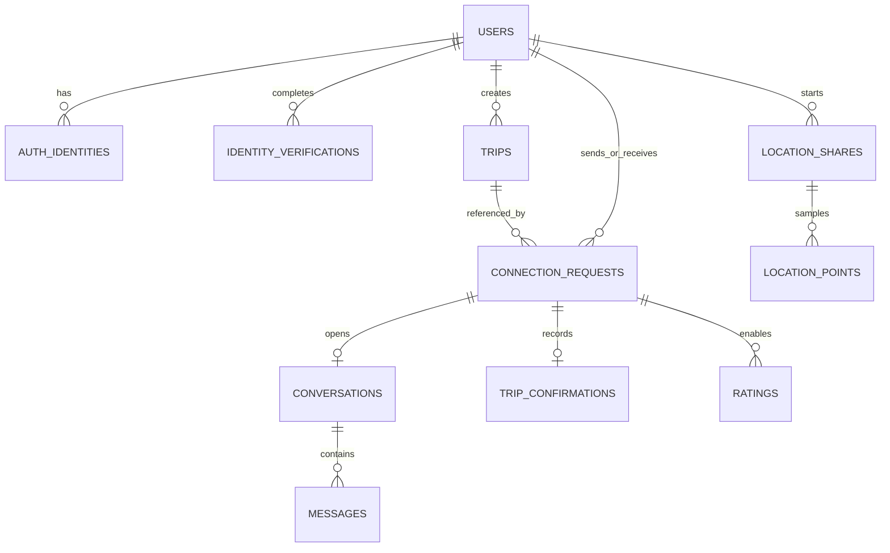

# Waymate Database Design

**Status:** Draft for discussion  
**Version:** 0.1  
**Date:** 12 October 2026  
**Database:** MongoDB Atlas, Mumbai (`ap-south-1`)  
**Scope:** Website-first release; subscriptions and payment handling are excluded.

## 1. Design principles

- Use MongoDB collections with references between independently changing records; avoid embedding unbounded messages, requests, or location history in a user document.
- Keep identity/authentication data separate from public profile data.
- Keep government-ID images and numbers out of MongoDB. Prefer DigiLocker/provider verification and retain status plus provider references only.
- Store image bytes in private S3; MongoDB stores object keys and metadata.
- Use GeoJSON for map points and route geometry. Public discovery returns approximate planned-trip details, never live location.
- Use TTL indexes for OTP challenges and time-limited location samples, while the API enforces expiry itself.
- Use indexes to support known queries; avoid indexing every field because indexes add storage and write cost.

## 2. Relationships



A connection is between two users and references the relevant trip listings. A trip can receive multiple separate requests; this design does not create group-trip membership.

## 3. Collections

### 3.1 `users`

One document per person. Separate public fields from private account state in the API projection.

```js
{
  _id: ObjectId,
  status: "pending_signup" | "active" | "paused" | "deletion_requested" | "suspended",
  primaryEmail: "person@example.com",
  primaryEmailNormalized: "person@example.com",
  phoneNumber: "+91...",
  phoneVerifiedAt: ISODate,
  profile: {
    displayName: "Asha",
    birthDate: ISODate,          // private; or store eligibility result if DOB is not needed
    adultEligible: true,
    gender: "female" | "male",
    photoAssetId: ObjectId,
    languages: ["en", "kn"],
    interests: ["food", "heritage"],
    bio: "Short introduction"
  },
  roles: ["traveler", "local"],
  localProfile: {
    enabled: false,
    areas: [],
    availability: [],
    description: null
  },
  discovery: {
    visible: true,
    genderPreference: "male" | "female",
    emailForRequests: true,
    emailForMessages: true
  },
  identityStatus: "not_started" | "pending" | "verified" | "failed" | "needs_review",
  createdAt: ISODate,
  updatedAt: ISODate,
  deletionRequestedAt: null
}
```

Do not expose phone, email, birth date, or private account state on map/profile cards. The gender enum reflects the current product decision and should be revisited if profile options expand.

### 3.2 `auth_identities`

Supports email/password and Google sign-in, with multiple login identities linked to a user.

```js
{
  _id: ObjectId,
  userId: ObjectId,
  provider: "password" | "google",
  providerSubject: "normalized-email-or-google-subject",
  passwordHash: "...",         // password provider only; never plaintext
  createdAt: ISODate,
  lastUsedAt: ISODate
}
```

For Google, use the provider's stable subject identifier. Account linking must require proof of control of the existing account; matching email alone should not silently merge accounts.

### 3.3 `signup_otp_challenges`

Short-lived signup phone-verification challenges.

```js
{
  _id: ObjectId,
  signupId: "opaque-random-id",
  phoneNumber: "+91...",
  codeHash: "...",
  attemptCount: 0,
  expiresAt: ISODate,
  consumedAt: null,
  createdAt: ISODate
}
```

Never persist the raw OTP. Rate-limit send, resend, and verify operations. The application must reject expired codes even if TTL cleanup has not run yet.

### 3.4 `identity_verifications`

DigiLocker or approved verification-provider outcome and audit reference.

```js
{
  _id: ObjectId,
  userId: ObjectId,
  provider: "digilocker" | "approved_provider" | "manual_review",
  status: "pending" | "verified" | "failed" | "needs_review",
  providerReference: "opaque-provider-reference",
  safeReasonCode: null,
  startedAt: ISODate,
  completedAt: null,
  createdAt: ISODate
}
```

Do not store ID images, ID numbers, access tokens, or full provider payloads here. Manual review is not ready for implementation until a secure handling and deletion process is approved.

### 3.5 `media_assets`

Metadata for profile images in S3; no binary content in MongoDB.

```js
{
  _id: ObjectId,
  ownerUserId: ObjectId,
  bucket: "private-waymate-profile-media",
  objectKey: "profiles/user-id/random-key.webp",
  mediaType: "image/webp",
  sizeBytes: 123456,
  status: "pending_upload" | "active" | "deleted",
  createdAt: ISODate
}
```

S3 should be private. The API issues short-lived, user-scoped upload URLs and returns safe image URLs or proxies image access according to the chosen visibility policy.

### 3.6 `trips`

A travel listing or local-companion availability listing.

```js
{
  _id: ObjectId,
  ownerUserId: ObjectId,
  tripType: "traveler" | "local",
  status: "active" | "paused" | "completed" | "cancelled",
  start: {
    placeId: "map-provider-id",
    label: "Mysuru area",
    point: { type: "Point", coordinates: [76.6394, 12.2958] }
  },
  destination: {
    placeId: "map-provider-id",
    label: "Mangaluru",
    point: { type: "Point", coordinates: [74.8560, 12.9141] }
  },
  departureAt: ISODate,
  timezone: "Asia/Kolkata",
  travelMode: "bus",
  companionshipFor: ["journey", "destination"],
  routeGeometry: {
    type: "LineString",
    coordinates: [[76.6394, 12.2958], [74.8560, 12.9141]]
  },
  displayGeometry: null,         // simplified/less precise map representation
  languages: ["en", "kn"],
  interests: ["food"],
  notes: "Optional trip note",
  createdAt: ISODate,
  updatedAt: ISODate
}
```

For local availability, the precise shape may differ from a point-to-point trip; finalize fields when local matching is specified. Store planned route data separately from live coordinates. Public map output should use approximate starting areas and approved display geometry.

### 3.7 `connection_requests`

One request between two users for a pair of relevant trip listings.

```js
{
  _id: ObjectId,
  senderUserId: ObjectId,
  recipientUserId: ObjectId,
  senderTripId: ObjectId,
  recipientTripId: ObjectId,
  status: "pending" | "accepted" | "declined" | "cancelled",
  message: "Optional request note",
  createdAt: ISODate,
  updatedAt: ISODate,
  decidedAt: null
}
```

Accepting a request creates one conversation. The API must prevent self-requests, enforce verification before sending/accepting, check blocks, and prevent duplicate pending requests for the same trip pair.

### 3.8 `conversations` and `messages`

```js
// conversations
{
  _id: ObjectId,
  connectionRequestId: ObjectId,
  participants: [
    { userId: ObjectId, lastReadAt: null }
  ],
  status: "active" | "closed",
  createdAt: ISODate
}

// messages
{
  _id: ObjectId,
  conversationId: ObjectId,
  senderUserId: ObjectId,
  body: "Message text",
  clientMessageId: "uuid-for-retry-deduplication",
  status: "sent" | "removed_by_moderation",
  createdAt: ISODate
}
```

A message is readable only to conversation participants. New messages and incoming requests create email outbox records; no other email event types are in scope.

### 3.9 `location_shares` and `location_points`

```js
// location_shares
{
  _id: ObjectId,
  tripId: ObjectId,
  ownerUserId: ObjectId,
  viewerUserIds: [ObjectId],
  status: "active" | "paused" | "stale" | "ended",
  startedAt: ISODate,
  lastReceivedAt: ISODate,
  endedAt: null,
  expiresAt: ISODate,
  latestPoint: {
    type: "Point",
    coordinates: [74.8560, 12.9141]
  },
  latestAccuracyMeters: 25
}

// location_points
{
  _id: ObjectId,
  shareId: ObjectId,
  ownerUserId: ObjectId,
  point: { type: "Point", coordinates: [74.8560, 12.9141] },
  accuracyMeters: 25,
  capturedAt: ISODate,
  expiresAt: ISODate
}
```

For the responsive website, the client sends updates only while Waymate is active and location permission is granted. Recipients see `stale` when updates stop; do not imply the user is still moving live. Only the owner and selected viewers can read the share. Keep a current point for the live view and short-lived samples for support/incident review. The exact retention interval is not yet decided.

### 3.10 `trip_confirmations` and `ratings`

```js
// trip_confirmations
{
  _id: ObjectId,
  connectionRequestId: ObjectId,
  confirmations: [
    { userId: ObjectId, occurred: true, submittedAt: ISODate }
  ],
  updatedAt: ISODate
}

// ratings
{
  _id: ObjectId,
  connectionRequestId: ObjectId,
  tripId: ObjectId,
  authorUserId: ObjectId,
  recipientUserId: ObjectId,
  score: 5,
  tags: ["communicative"],
  comment: "Optional review",
  status: "pending" | "visible" | "reported" | "removed",
  createdAt: ISODate
}
```

The API enables rating only after the agreed trip-confirmation rule is met. One author may submit at most one rating per connection. Rating scale, visibility, comment rules, and dispute workflow remain open.

### 3.11 `user_blocks`, `reports`, and `notification_outbox`

```js
// user_blocks
{ _id: ObjectId, blockerUserId: ObjectId, blockedUserId: ObjectId, createdAt: ISODate }

// reports
{
  _id: ObjectId,
  reporterUserId: ObjectId,
  targetType: "user" | "message" | "trip" | "rating",
  targetId: ObjectId,
  reasonCode: "...",
  details: "Optional text",
  status: "open" | "reviewing" | "resolved" | "dismissed",
  createdAt: ISODate,
  resolvedAt: null
}

// notification_outbox
{
  _id: ObjectId,
  dedupeKey: "event-type:entity-id:recipient-id",
  recipientUserId: ObjectId,
  eventType: "connection_request_received" | "message_received",
  entityId: ObjectId,
  status: "pending" | "sent" | "failed",
  attempts: 0,
  nextAttemptAt: ISODate,
  createdAt: ISODate,
  sentAt: null
}
```

The outbox lets the monolith retry email delivery without losing the source request or message. Email provider credentials remain in AWS Secrets Manager, not MongoDB.

## 4. Index plan

The following indexes support the known product queries. Exact names and partial-index filters can be finalized alongside implementation.

```js
// Users and login identities
users.createIndex({ primaryEmailNormalized: 1 }, {
  unique: true,
  partialFilterExpression: { primaryEmailNormalized: { $type: "string" } }
});
users.createIndex({ phoneNumber: 1 }, {
  unique: true,
  partialFilterExpression: { phoneVerifiedAt: { $type: "date" } }
});
auth_identities.createIndex({ provider: 1, providerSubject: 1 }, { unique: true });
auth_identities.createIndex({ userId: 1 });

// Signup OTP expiry
signup_otp_challenges.createIndex({ expiresAt: 1 }, { expireAfterSeconds: 0 });
signup_otp_challenges.createIndex({ signupId: 1, consumedAt: 1 });

// Trips: scalar discovery and geospatial candidate retrieval
trips.createIndex({ status: 1, "destination.placeId": 1, departureAt: 1 });
trips.createIndex({ status: 1, travelMode: 1, departureAt: 1 });
trips.createIndex({ "start.point": "2dsphere" });
trips.createIndex({ "destination.point": "2dsphere" });
trips.createIndex({ routeGeometry: "2dsphere" });

// Requests and conversation/message timelines
connection_requests.createIndex({ recipientUserId: 1, status: 1, createdAt: -1 });
connection_requests.createIndex({ senderUserId: 1, status: 1, createdAt: -1 });
connection_requests.createIndex({ senderTripId: 1, recipientTripId: 1, status: 1 });
conversations.createIndex({ connectionRequestId: 1 }, { unique: true });
conversations.createIndex({ "participants.userId": 1, status: 1 });
messages.createIndex({ conversationId: 1, createdAt: -1 });
messages.createIndex({ conversationId: 1, senderUserId: 1, clientMessageId: 1 }, { unique: true });

// Location share access and retention
location_shares.createIndex({ ownerUserId: 1, status: 1 });
location_shares.createIndex({ viewerUserIds: 1, status: 1 });
location_shares.createIndex({ expiresAt: 1 }, { expireAfterSeconds: 0 });
location_points.createIndex({ shareId: 1, capturedAt: -1 });
location_points.createIndex({ expiresAt: 1 }, { expireAfterSeconds: 0 });

// Ratings, moderation, email delivery
ratings.createIndex({ connectionRequestId: 1, authorUserId: 1 }, { unique: true });
ratings.createIndex({ recipientUserId: 1, status: 1, createdAt: -1 });
user_blocks.createIndex({ blockerUserId: 1, blockedUserId: 1 }, { unique: true });
reports.createIndex({ status: 1, createdAt: 1 });
notification_outbox.createIndex({ dedupeKey: 1 }, { unique: true });
notification_outbox.createIndex({ status: 1, nextAttemptAt: 1 });
```

MongoDB TTL cleanup is asynchronous; authorization and read paths must check `expiresAt` directly rather than relying on deletion to happen at the exact expiry time. Route geospatial indexes help narrow candidates but do not define product-level route-overlap scoring.

## 5. Access boundaries

- **Public profile/map projection:** display name, photo, verification badge, selected languages/interests, Local tag, and relevant planned-trip summary only.
- **Private account data:** email, phone, authentication identities, birth date/eligibility evidence, and notification settings.
- **Verification records:** provider status/reference and audit metadata only.
- **Location:** current active share and brief sample history visible only to owner and authorized recipients.
- **Messages:** visible only to conversation participants and authorized moderation workflows.
- **Images:** private S3 objects; access controlled by Waymate’s approved image-delivery strategy.

## 6. Operational notes

- MongoDB transactions may be used when an operation must atomically change multiple documents, such as accepting a request and creating its conversation. Keep external email delivery outside the transaction through the outbox pattern.
- Indexes should be introduced with migrations and checked against real query plans before public traffic.
- S3 keys, DigiLocker references, map-provider IDs, and payment/provider credentials must not be treated as user-facing secrets or returned without a specific need.
- No subscription, fare, taxi-booking, or payment collections are included.

## 7. Decisions still needed

1. Exact location-sample retention duration and deletion behavior after an incident report.
2. Whether trusted contacts must have Waymate accounts or can receive an expiring external share link.
3. Whether users may create multiple active trips and how many active connections each trip permits.
4. Exact adult-eligibility data retained after identity verification; avoid retaining full birth date unless necessary.
5. Supported travel modes and local-companion availability schema.
6. Rating scale, publication rules, and dispute handling.
7. Account deletion and message-retention policy.
8. Whether public discovery profiles require verified identity status before appearing, or only before requests/acceptance.
