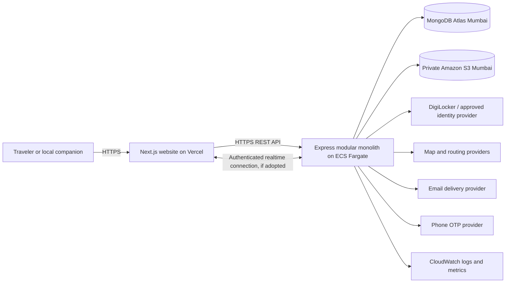
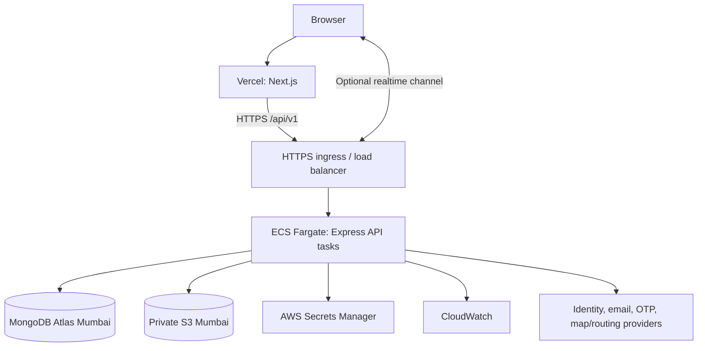

# Waymate System Design

**Status:** Draft for review  
**Version:** 0.1  
**Date:** 18 October 2026  
**Scope:** Website-first initial release

## 1. Purpose

This document describes the proposed runtime architecture, major components, trust boundaries, and key data flows for Waymate. It aligns with the current PRD, database design, and API design drafts. It is an implementation guide, not a deployment runbook; unresolved decisions are listed at the end.

## 2. Product and architecture decisions

- Waymate is an adults-only travel companion discovery service, not a dating, transport-booking, taxi, or payment platform.
- The first client is a responsive website for phone and laptop screens. The signed-in experience is map-first.
- The frontend uses Next.js and is hosted on Vercel.
- The backend is a **modular monolith**: one Node.js + Express API application, organized into domain modules and deployed as one service on AWS ECS Fargate. It is not a collection of independently deployed microservices.
- MongoDB Atlas is the managed database, in the Mumbai region (`ap-south-1`).
- Amazon S3 in Mumbai stores profile-image objects. MongoDB stores metadata and object keys, not image bytes.
- MapLibre renders the web map. OpenStreetMap-based data and openrouteservice are the initial map/routing direction; provider configuration and usage limits must be reviewed before public launch.
- DigiLocker through API Setu is the preferred government identity-verification direction, subject to approval. An approved provider or a carefully defined manual review may be a fallback.
- Subscription, payment collection, transport booking, and police/criminal-record screening are outside the initial release.
- Location sharing is opt-in, foreground-only, and best-effort in a browser. It is not available after the page is closed or guaranteed while backgrounded.

## 3. System context

The browser communicates with the Waymate API for application data. The API enforces authorization and privacy rules before accessing persisted data or calling external services. External services are dependencies behind server-side adapters wherever secrets or privileged credentials are involved.

## 4. Deployment view

### 4.1 Web application

- Next.js application deployed to Vercel.
- Responsive UI, public landing and account pages, signed-in map discovery, trip/profile forms, request inbox, messaging, and settings.
- MapLibre renders tiles and route overlays in the browser. The UI requests discovery data from the API and renders only the API's privacy-filtered projection.
- Browser secrets are not used for privileged provider access. Public map configuration may be client-visible only when the provider explicitly supports public keys and domain restrictions.
- Production and preview deployments must use separate API origins and environment configuration.

### 4.2 Backend API

- One Node.js + Express service deployed as an ECS Fargate service behind an HTTPS load balancer/API ingress.
- Stateless application instances; durable application state is in MongoDB Atlas or S3. Sessions may use a server-side shared session store if cookie sessions are selected; do not keep authoritative sessions only in process memory when running multiple tasks.
- REST/JSON API under `/api/v1`.
- A single deployable application with internal modules for identity/authentication, accounts, verification, trips, discovery, connections, messaging, location sharing, ratings/moderation, media, and notifications.
- External integrations use provider adapters so DigiLocker, email, SMS, maps, and object storage can be configured or replaced without spreading provider-specific logic through domain code.

### 4.3 Data and operations

- MongoDB Atlas is the system of record for users, trips, requests, conversations, messages, notification outbox entries, verification status, and other application metadata.
- S3 stores private profile images. Access is mediated by short-lived, user-scoped upload URLs and an approved image-delivery policy.
- AWS Secrets Manager holds backend credentials and provider secrets. No real secrets are committed to Git or exposed to the browser.
- CloudWatch receives service logs, metrics, and alarms. Logs must redact passwords, OTPs, OAuth tokens, identity data, and precise location coordinates.
- Backups, retention, restore drills, and production alert thresholds need configuration before public launch.

## 5. Backend module boundaries

Each module owns its domain rules and persistence operations. Modules may call one another through application services; avoid circular dependencies and direct cross-module collection access where practical.

| Module | Responsibilities |
|---|---|
| Auth and sessions | Email/password, Google OAuth, signup OTP orchestration, session creation and revocation, password recovery |
| Accounts and profiles | Individual account, profile fields, visibility, discovery preferences, adult eligibility state |
| Identity verification | DigiLocker/provider initiation and callbacks, verification state, safe audit references |
| Trips and local availability | Create/edit/pause trips and local companion availability; validate routes and travel details |
| Discovery | Same-destination, reverse-direction, route-overlap, and local-companion queries; filter results and map markers |
| Connections | Request lifecycle, eligibility checks, acceptance/decline, blocking rules, and conversation creation |
| Messaging | Conversation membership, message persistence, read state, and realtime event publication if adopted |
| Location sharing | Explicit sharing consent, authorized recipients, update lifecycle, stale status, and retention controls |
| Media | S3 upload authorization, asset metadata, ownership, and deletion |
| Notifications | Email outbox, request/message notification templates, retries, and preference checks |
| Ratings and safety operations | Trip confirmation, ratings, reports, moderation workflow, and account actions |

## 6. Core data ownership

MongoDB collections follow the database design draft. Key boundaries:

- `users` and `auth_identities`: private account/profile state and login identities. Public profile endpoints return an explicit allowlisted projection.
- `signup_otp_challenges`: hashed, short-lived OTP challenges; never store the raw code.
- `identity_verifications`: provider, state, safe reason code, timestamps, and opaque provider reference. Avoid storing government-ID images, numbers, tokens, or full provider responses.
- `trips`: planned route and local availability data. Discovery geometry is approximate and distinct from live location.
- `connection_requests`, `conversations`, and `messages`: scoped to participants; messaging opens only after request acceptance.
- `location_shares` and short-lived `location_points`: accessible only to the owner and explicitly authorized recipients. Expiration is checked by API logic; TTL cleanup is asynchronous.
- `notification_outbox`: durable intent to email on new requests and new messages, with deduplication and retry state.
- `media_assets`: S3 object key, owner, media type, size, and lifecycle status. Image bytes remain in S3.

Use indexes from the database design document, then validate key query plans against representative data before launch. Geospatial indexes help narrow candidates; product logic still scores route overlap and departure-time compatibility.

## 7. Primary request and data flows

### 7.1 Signup and identity verification

1. Browser submits email/password and phone number to the API, or starts Google OAuth.
2. API validates input, creates a pending signup/account state, and sends a phone OTP through the configured provider.
3. User submits the OTP; API validates the hashed challenge, attempt limits, expiry, and phone ownership.
4. User completes the identity provider flow. API validates callback state and records only the provider outcome/reference and required audit metadata.
5. API marks verification status. A user may browse according to the product policy, but must have verified identity before sending or accepting connection requests.
6. The UI displays a clear verification status. It must not imply police clearance or guarantee safety.

### 7.2 Trip creation and map discovery

1. A signed-in user creates a traveler trip or enables a Local profile/availability listing.
2. API validates dates, travel mode, destination, route geometry, profile visibility, and supported fields, then persists the listing.
3. The map UI requests discovery results using viewport and trip filters.
4. Discovery module applies visibility, account state, gender preference, blocks, eligibility, route/destination, timing, and travel-mode rules server-side.
5. API returns approximate planned-trip markers and profile-card summaries only. It does not return precise home/pickup data, identity material, or live location.
6. User selects a marker/card and reviews the profile and relevant route details before requesting a connection.

### 7.3 Connection request, chat, and email

1. API checks the sender and recipient are eligible, both required identity states are verified, the listing is active, no block applies, and no duplicate request exists.
2. API stores the request as pending and enqueues a `connection_request_received` email in the notification outbox.
3. Recipient accepts or declines. On acceptance, the API creates exactly one conversation for the request (using a transaction or equivalent idempotent operation).
4. Only participants can read/send messages. Each new message is persisted and an email notification is enqueued if the recipient's preference allows it.
5. Email contains a minimal notice and a link back to Waymate; it omits sensitive identity information and precise location.

### 7.4 Foreground trip location sharing

1. User explicitly starts sharing for a trip and selects authorized recipients.
2. Browser requests location permission and sends position updates only while the Waymate page is active and sharing is enabled.
3. API verifies ownership, trip state, recipient access, rate limits, coordinate validity, and timestamp freshness.
4. Authorized recipients can view the latest point and status. If updates stop, the UI marks the last point stale; it does not imply tracking is still active.
5. User can pause/end sharing. Sharing also ends with the trip according to the finalized policy. Retention duration for samples is an open decision.

### 7.5 Trip confirmation and rating

1. Connected users submit their own trip-occurrence confirmation.
2. API makes rating available only when the agreed confirmation rule is satisfied.
3. Each participant can submit one rating per connection under the selected publication policy.
4. Reports enter a moderation queue. Ratings and verification are not safety guarantees.

## 8. API and communication choices

- Use REST/JSON for signup, profiles, trips, discovery, connection lifecycle, messages, ratings, and settings.
- Use cursor pagination on unbounded lists such as discovery, messages, and request history.
- Proposed authentication is a secure, HTTP-only browser session cookie. Confirm cookie domain, SameSite, CSRF, CORS, and Vercel/API origin strategy before implementation.
- Use WebSockets only if the initial user experience requires near-real-time chat/location. Authenticate the connection and authorize every conversation or location subscription server-side. If operational complexity is too high for the first increment, begin with REST polling and keep the event contract transport-neutral.
- Never trust browser-supplied user IDs, role claims, recipient lists, or verification status; derive identity and enforce policy on the API.
- The OpenAPI/API design document is the contract source for endpoint names, payloads, errors, and status codes. Update it alongside implementation changes.

## 9. Security, privacy, and safety controls

- Require authentication and resource-level authorization on protected endpoints.
- Require government identity verification before request send or accept actions; phone OTP proves control of a phone number only.
- Keep passwords hashed with a suitable password-hashing algorithm; protect OAuth state and prevent unsafe account linking.
- Rate-limit signup, OTP, login, password reset, connection requests, message send, and location updates.
- Validate request bodies, cap payload sizes, encode/render user text safely, and apply strict CORS and CSRF protections for cookie sessions.
- Use private S3 buckets and short-lived user-scoped uploads; validate file size, declared type, and actual image content.
- Use least-privilege IAM roles and Secrets Manager for service credentials.
- Keep live location out of discovery and use explicit sharing recipients. Do not expose raw coordinates in normal logs, analytics, or error reports.
- Minimize identity-provider data; do not store government ID documents in MongoDB. Manual review requires a separately approved secure workflow and retention schedule.
- Provide block, report, account support, and data-deletion pathways before public launch.
- Email notifications are limited to new connection requests and new messages for the first release, with preferences and deduplication.

## 10. Reliability and operations

- Keep API tasks stateless so ECS can replace and scale them horizontally.
- Use health/readiness endpoints; readiness should reflect required startup dependencies without leaking credentials or connection strings.
- Set bounded timeouts and controlled retries for external providers. Retry only safe/idempotent calls; use idempotency keys and outbox deduplication for user-facing writes and email delivery.
- External provider failure should not silently create a verified identity, confirmed trip, or sent notification. Represent pending/failed states explicitly.
- Configure database connection pooling and task limits to avoid exhausting Atlas connections when ECS scales out.
- Monitor request rate, latency, error rate, task health, database connectivity, outbox backlog, OTP/email delivery outcomes, and provider callback failures.
- Establish backup/restore, incident response, location-data retention, and deletion procedures before production launch.
- Use separate development, preview, and production configuration and credentials. Never use production identity data in development.

## 11. Environments and configuration

| Environment | Purpose | Data and credentials |
|---|---|---|
| Local development | Build and manual development | Local MongoDB or isolated development Atlas database; fake/mock integrations where possible; `.env.local` ignored by Git |
| Preview/staging | Validate integrated flows | Separate Atlas database, S3 bucket/prefix, OAuth app, provider sandbox credentials, and email/OTP sandbox where available |
| Production | Public service | Mumbai-region managed data services, production provider credentials in Secrets Manager, restricted operator access, backups and monitoring |

The repository should include `.env.example` containing variable names and placeholders only. Environment variable names and validation should be defined in implementation; actual secrets must not enter source control.

## 12. Initial deployment topology

The exact ingress choice, networking model, domain arrangement, Vercel-to-API cookie configuration, and realtime transport need confirmation before production infrastructure is provisioned.

## 13. Decisions and risks to resolve before implementation

1. **Repository/tooling:** confirm monorepo layout, TypeScript, package manager, and local developer workflow.
2. **Authentication deployment:** confirm secure session-cookie strategy across the Vercel website and ECS API; decide whether a shared session store is needed.
3. **Signup lifecycle:** decide whether email confirmation is required in addition to phone OTP and how Google-only accounts complete phone verification.
4. **Adult eligibility:** define the age threshold, how it is checked, and what minimum evidence is retained.
5. **Identity provider:** confirm API Setu requester approval, provider responsibilities, callback security, manual fallback process, and data-retention requirements.
6. **Map/routing:** validate route and geocoding quality in initial launch cities; choose hosted tile provider and confirm attribution, limits, and budget before public scale.
7. **Realtime:** decide WebSocket now versus REST polling for initial chat/location experience.
8. **Email and OTP providers:** select vendors, verify sender/domain setup, retry and bounce handling, and regional requirements.
9. **Location privacy:** define update frequency, sample retention, stale threshold, emergency/incident access, trusted contacts, and deletion behavior.
10. **Ratings and moderation:** define mutual trip confirmation, rating scale/visibility, report handling, and appeals.
11. **Local companion model:** finalize local availability fields and any city-specific requirements for paid guiding. Waymate will not process those fees in this release.
12. **Operations:** define launch regions, support coverage, data retention/deletion, backup/restore objectives, and incident response.

## 14. Suggested implementation sequence

1. Confirm repository scaffold and runtime configuration; create the Next.js website and Express modular-monolith API.
2. Establish health/readiness behavior, structured logs with redaction, configuration validation, and a local API-to-web connection.
3. Implement account signup/login/session and profile creation, keeping OTP and OAuth provider integrations behind adapters.
4. Implement identity-verification state and provider integration after provider approval and handling requirements are clear.
5. Implement trips/local availability and discovery queries, then map/card rendering with approximate data.
6. Implement connection requests, acceptance, conversations, and messaging; then request/message email outbox delivery.
7. Implement opt-in foreground location sharing with explicit recipient authorization and stale-state handling.
8. Implement trip confirmation, ratings, reporting, and moderation operations.
9. Prepare production infrastructure, observability, retention/deletion procedures, and launch readiness.

Subscription plans, fare handling, taxi booking, and criminal-record screening remain out of scope.
